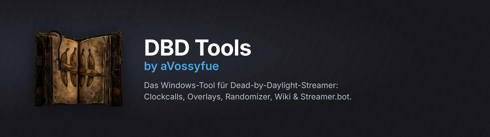
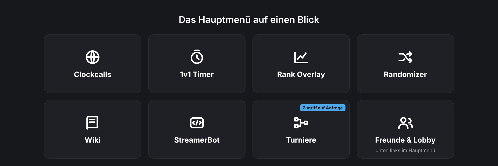
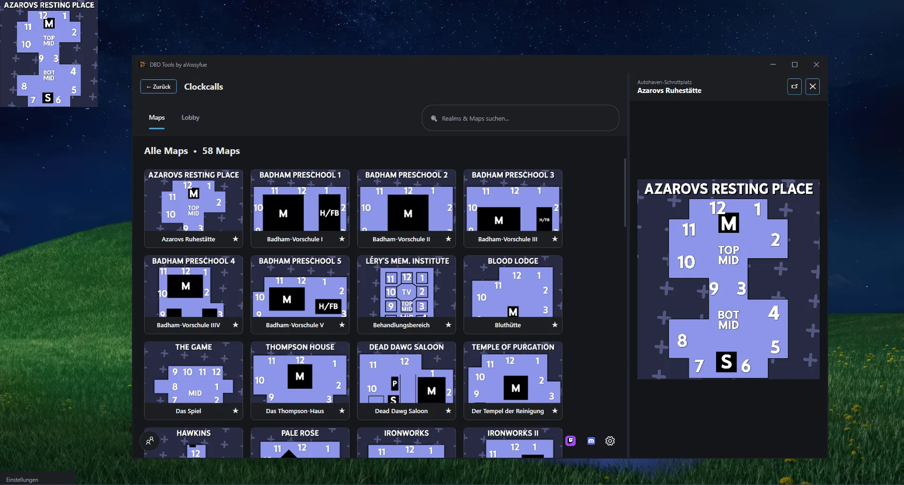
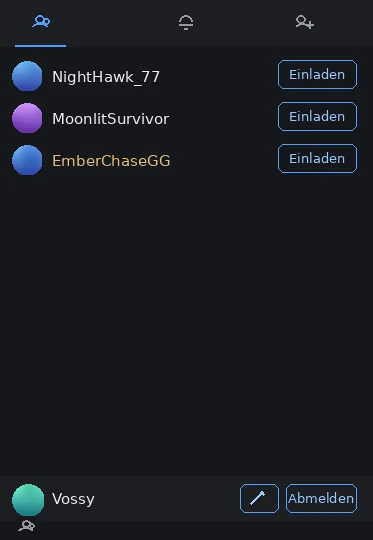
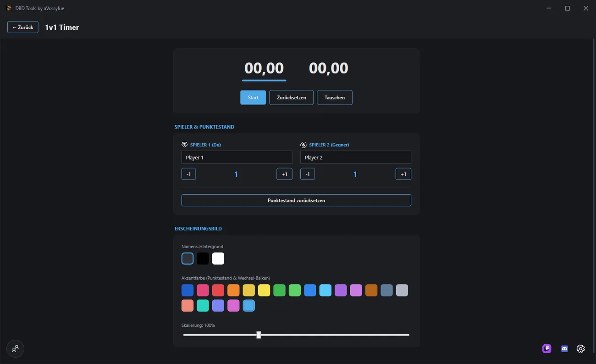
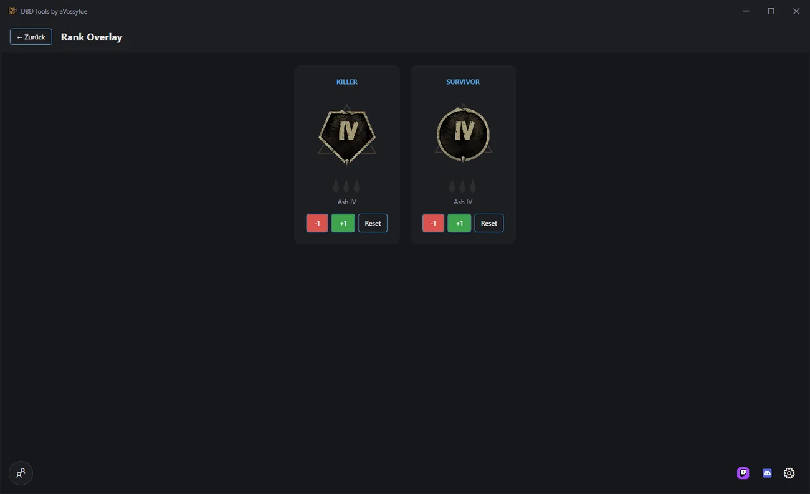
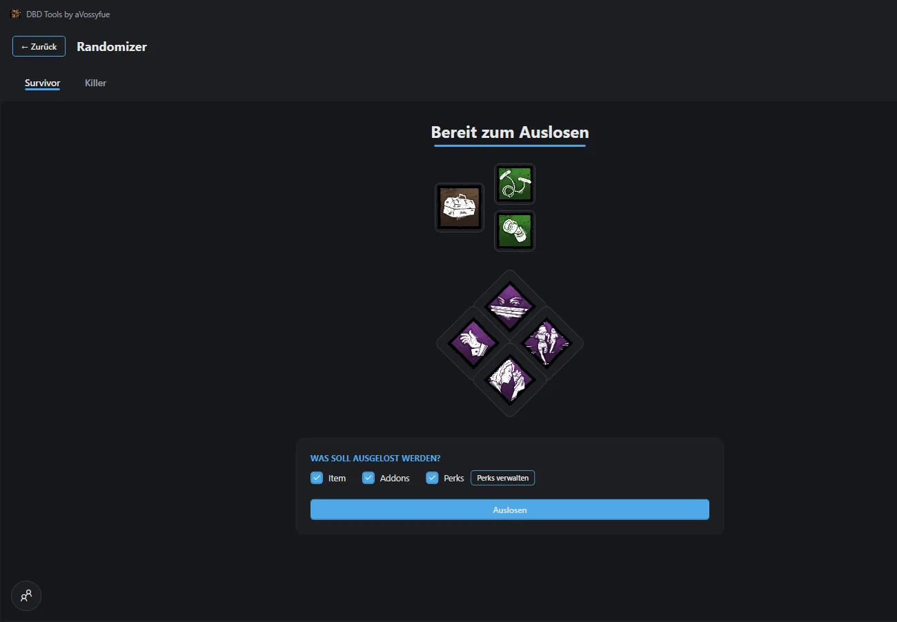
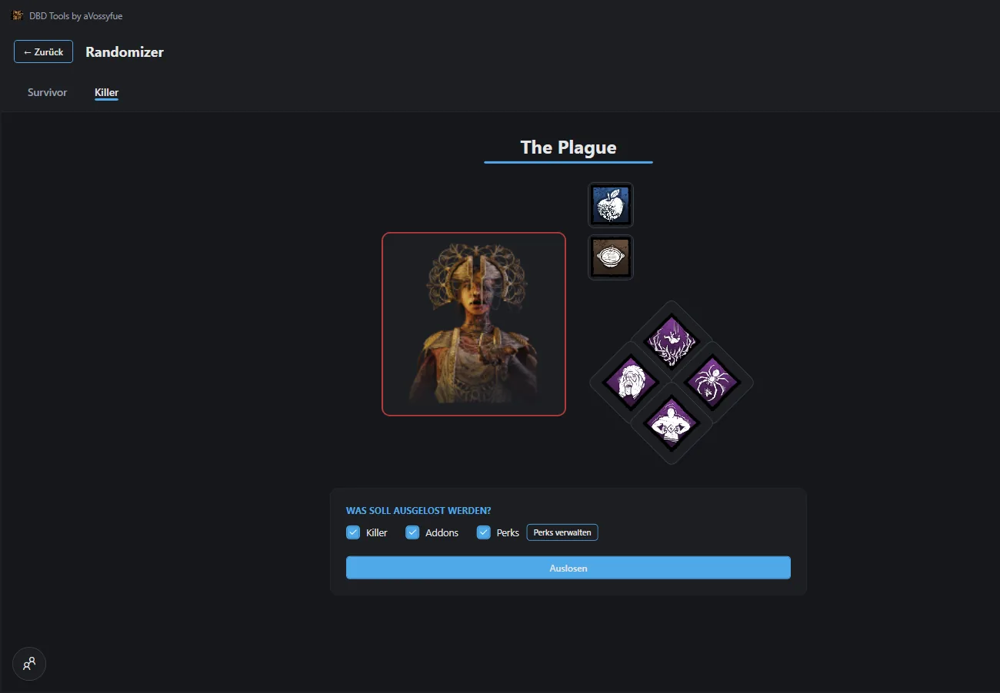

[README.md](https://github.com/user-attachments/files/34691571/README.md)

**Ein Windows-Programm für Dead-by-Daylight-Streamer: Karten-Archiv mit automatischer Map-Erkennung, OBS-Overlays, Randomizer, Wiki, Freundesliste mit Lobby, Turnierverwaltung und eine Erweiterung für Streamer.bot.**

---

## Inhaltsverzeichnis

- [Überblick](#überblick)
- [Hauptmenü](#hauptmenü)
- [Clockcalls: Karten-Archiv](#clockcalls-karten-archiv)
- [Freunde und Lobby](#freunde-und-lobby)
- [1v1 Timer](#1v1-timer)
- [Rank Overlay](#rank-overlay)
- [Randomizer](#randomizer)
- [Wiki](#wiki)
- [StreamerBot: Perk Randomizer](#streamerbot-perk-randomizer)
- [Turniere](#turniere)
- [OBS-Overlays](#obs-overlays)
- [Einstellungen und Hotkeys](#einstellungen-und-hotkeys)
- [Weitere Funktionen](#weitere-funktionen)
- [Installation](#installation)
- [Aus dem Quellcode bauen](#aus-dem-quellcode-bauen)
- [Technischer Aufbau](#technischer-aufbau)
- [Webseite und Dokumentation](#webseite-und-dokumentation)
- [Hinweise und Quellen](#hinweise-und-quellen)

---

## Überblick

DBD Tools bündelt alles, was ein Dead-by-Daylight-Streamer neben dem Spiel braucht, in einer App. Die Oberfläche ist dunkel, schnell und in fünf Sprachen verfügbar. Alles, was im Stream sichtbar sein soll, läuft als Browserquelle mit transparentem Hintergrund in OBS.

| Bereich | Was du bekommst |
|---|---|
| **Clockcalls** | Alle 21 Realms und 58 Maps mit Suche, Favoriten und angedockter Vorschau, dazu automatische Map-Erkennung aus dem laufenden Spiel |
| **Freunde und Lobby** | Anmeldung mit Discord oder Twitch, Online-Status und gemeinsame Kartenauswahl in Echtzeit |
| **1v1 Timer** | Zwei Timer, Punktestand, eigene Farben und eigenes OBS-Overlay |
| **Rank Overlay** | Killer- und Survivor-Rang mit allen 20 Rangstufen als Grafik im Stream |
| **Randomizer** | Killer und Survivor mit Addons, Items und Perks auslosen, mit Slot-Maschinen-Effekt |
| **Wiki** | Alle Killer, Survivor, Perks, Add-ons, Statuseffekte und Spiel-Patches |
| **StreamerBot** | Fertiger Perk Randomizer für den Twitch-Chat per Importstring, mit OBS-Overlay, Warteschlange und Dock |
| **Turniere** | Komplette Turnierverwaltung mit Discord-Draft und Overlays (Zugriff auf Anfrage) |

Die App läuft nach der Installation lokal. Ein Konto brauchst du nur für Freundesliste, Lobby und Turniere. Clockcalls, Timer, Rank Overlay, Randomizer und Wiki funktionieren auch ohne Anmeldung.

---

## Hauptmenü

Jedes Werkzeug hat eine eigene Kachel. Unten links öffnest du die Freundesliste, unten rechts findest du Twitch, Discord und die Einstellungen. Über „Fehler melden“ erreichst du den Entwickler direkt aus der App.

---

## Clockcalls: Karten-Archiv

- **21 Realms, 58 Maps** mit Bildern. Die Maps sind alphabetisch sortiert, **Favoriten** (Sternchen) stehen im Realm-Dropdown immer ganz oben.
- **Live-Suche** über Realms und Maps gleichzeitig, mehrsprachig.
- **Angedocktes Vorschau-Panel** rechts neben den Kacheln, in der Breite per Drag verstellbar.
- **Popout-Fenster**: Die Vorschau lässt sich als freies Fenster herauslösen und folgt automatisch der Auswahl im Hauptfenster. Weder das Popout noch Benachrichtigungen holen das laufende Spiel aus dem Fokus.
- **Overlay im Stream**: Die gewählte Map erscheint als transparentes Overlay über einen lokalen Server und lässt sich als Browserquelle in OBS einbinden. Position, Größe und Transparenz sind einstellbar, auch der Zielmonitor.

### Automatische Map-Erkennung

Die App liest den Kartennamen aus dem laufenden Spiel und zeigt die passende Map automatisch an.

- Funktioniert mit **Steam, Epic und Microsoft Store**.
- Die Texterkennung nutzt Windows. Bleibt der erste Versuch ohne Treffer, liest sie das Bild in mehreren aufbereiteten Fassungen erneut.
- Läuft die automatische Suche bei dir nicht, wählst du das Spiel im Dropdown **„Erkennung aus Anwendung“** selbst aus der Liste der offenen Programme.
- **„Erkennung testen“** in den Einstellungen zeigt, ob das Fenster gefunden wird, welcher Text gelesen wurde und welche Map erkannt wurde. Die Logs landen in `clockcalls.log` und lassen sich beim Fehlermelden mitschicken.
- Die Erkennung lässt sich per Schalter oder Hotkey ein- und ausschalten.

### Schnellsuche

Ein frei belegbarer Hotkey blendet eine kleine Suchleiste über allem ein. Damit wechselst du die Map, ohne aus dem Spiel in die App zu wechseln. Das ist praktisch, wenn die automatische Erkennung ausgeschaltet ist.

---

## Freunde und Lobby

Die Anmeldung ist bewusst optional. Der Rest der App funktioniert auch ohne Konto.

- **Anmeldung mit Discord oder Twitch**, die Sitzung wird mit Windows-Verschlüsselung (DPAPI) gespeichert.
- **Freunde hinzufügen** per persönlichem 6-stelligen Freundescode oder per Nutzernamen-Suche.
- **Profilbilder** aus Discord oder Twitch, jederzeit änderbar, inklusive Zuschnitt direkt im Fenster. Dazu ein eigener Anzeigename.
- **Online, Abwesend, Offline** je Freund in Echtzeit. „Abwesend“ gilt nach 5 Minuten Inaktivität.
- **Benachrichtigungen** für Freundschaftsanfragen und Lobby-Einladungen an einem Ort, mit Zähler am Freundesliste-Symbol, in der Taskleiste und im Tray.
- **Lobby**: Sie öffnet sich automatisch, sobald du den ersten Freund einlädst. Du kannst sie auch manuell erstellen. Die Mitglieder erscheinen als Bubbles mit Avatar, der Lobbyführer mit Krone. Er kann Mitglieder entfernen, die Berechtigung „Maps für alle ändern“ vergeben und die Führung übertragen. Die Kartenauswahl wird live mit allen geteilt.

---

## 1v1 Timer

- Zwei parallele Timer mit **Start, Zurücksetzen und Tauschen**.
- **Punktestand** für beide Spieler. Die Killer- und Survivor-Symbole wechseln beim Tauschen automatisch mit.
- Freie Wahl von **Namens-Hintergrund** und **Akzentfarbe**, Overlay-Skalierung einstellbar.
- **Globaler Hotkey** zum Starten und Stoppen, auch außerhalb der App.
- Eigener **OBS-Overlay-Link**.

---

## Rank Overlay

- Killer- und Survivor-Rang unabhängig voneinander, **alle 20 Rangstufen** als eigene Grafiken (Ash IV bis Iridescent I).
- Steuerung direkt in der App mit **+1, -1 und Reset**, auch per Hotkey.
- Anzeigemodus **Killer, Survivor oder Beide**.
- Eigener **OBS-Overlay-Link**.

---

## Randomizer

Zwei Reiter, **Survivor** und **Killer**, jeweils mit eigenem Ergebnis und Slot-Maschinen-Effekt.

- **Survivor**: 1 Item mit Seltenheitsstufe, 2 passende Addons und 4 Perks.
- **Killer**: 1 Killer, 2 **killerspezifische** Addons und 4 Perks. Die Addons passen garantiert zum gezogenen Killer. Die Überschrift zeigt den Namen des Killers.
- **Checkboxen** bestimmen, was ausgelost wird. Nicht gewählte Bereiche werden ausgeblendet.
- **„Perks verwalten“**: Einzelne Perks lassen sich von der Auslosung ausschließen, zum Beispiel, wenn du sie noch nicht besitzt. Mit Bildvorschau und Suche.
- **Hover-Karten** wie im Spiel: Mit der Maus über Killer, Perks oder Add-ons erscheinen Name und Beschreibung. Beim Killer siehst du eine gekürzte Beschreibung seiner Kraft.
- Ein **Klick** auf einen Perk, Killer oder ein Add-on öffnet die passende Wiki-Seite als Popup.
- Ergebnisse bleiben erhalten, wenn du den Reiter wechselst oder die Seite kurz verlässt.

---

## Wiki

Ein Nachschlagewerk direkt in der App, auf Deutsch (mit englischem Fallback) und durchsuchbar.

- **Killer und Survivor**: Raster aller Charaktere. Die Detailseite zeigt Lore, Eckdaten (Herkunft, Realm, Fähigkeit, Geschwindigkeit, Terrorradius und mehr), Perks, Fähigkeiten, DLC und Wissenswertes.
- **Killer-Add-ons**: Auf jeder Killer-Seite stehen alle 20 Add-ons mit Bild und Beschreibung, nach Seltenheit sortiert und mit Farbbalken markiert.
- **Perks**: Alle Perks mit Funktion, getrennt nach Survivor und Killer, nach Charakter gruppiert und nach Erscheinungsdatum sortiert. Die Suche findet deutsche und englische Namen sowie Charaktere.
- **Statuseffekte**: Alle Effekte aus dem Spiel mit Symbol, Beschreibung, Seite (Survivor oder Killer) und positiv oder negativ. In den Texten steht vor einem Statuseffekt sein Symbol, wie im Online-Wiki.
- **Patches**: Die Patchnotes von Dead by Daylight, direkt aus den offiziellen Steam-News (englisch). Neue Patches erscheinen automatisch, ohne dass die App aktualisiert werden muss. Der letzte Stand bleibt offline verfügbar.

---

## StreamerBot: Perk Randomizer

Eine fertige Erweiterung für [Streamer.bot](https://streamer.bot): Dein Twitch-Chat würfelt per Befehl oder Kanalpunkten Survivor- und Killer-Builds aus **321 Perks**. Importstring kopieren, einrichten, fertig. Die Anleitung steht in der App (Kachel **StreamerBot**) und auf der [Webseite](https://dbd-tools.vercel.app/streamerbot-perk-randomizer.html).

**Funktionen (Version 1.2)**

- **Befehle** `!rollSurv` und `!rollKiller`, auch für andere Personen (`!rollKiller @Name`).
- **Kanalpunkte und Power-ups** werden automatisch erkannt und würfeln für den Streamer.
- **Einstellungsfenster mit sechs Reitern**: Survivor, Killer, Nachrichten, Overlay, Warteschlange und Beispiele. Perk-Anzahl von 1 bis 4, eigener Perk-Pool, Namen in Deutsch oder Englisch, Besitzer-Anzeige.
- **Eigene Nachrichten** mit Platzhaltern (`{user}`, `{target}`, `{perks}`, `{count}`, `{side}`), wahlweise über den Bot-Account.
- **OBS-Overlay** in drei Layouts: **Loadout, Karte und Banner**. Mit einstellbarer Anzeigedauer, Test-Button und kopierbarem Overlay-Link.
- **Warteschlange**: Würfe laufen nacheinander. Du kannst **manuell würfeln**, festlegen, ob alle Trigger oder nur Kanalpunkte und Power-ups eingereiht werden, eine **Chat-Verzögerung** setzen (Standard 5 Sekunden) und eine **Wartenachricht** für Zuschauer einstellen.
- **OBS-Dock**: Die Warteschlange sieht und steuerst du in einem benutzerdefinierten Browser-Dock von OBS.
- **Argumente für eigene Actions**: `%perkBuild%`, `%perkList%`, `%perkSide%`, `%perkUser%`, `%perkTarget%` und `%perkMessage%`.

Für Overlay und Dock muss der WebSocket-Server von Streamer.bot laufen (Auto Start, `127.0.0.1`, Port `8080`). Der Importstring enthält vier Actions, zwei Befehle und die komplette Perkliste und wird beim Kopieren per SHA-256 geprüft.

---

## Turniere

Eine vollständige Turnierverwaltung, die direkt in der App läuft. Der Bereich ist in der App enthalten, aber **nur für freigegebene Personen** nutzbar. Die Freigabe gibt es auf Anfrage über ein Kontaktformular in der App.

- **Setup**, **Gruppenphase** mit Tabellen, **Turnierbaum** mit Rematch-Sperre und **Datenvalidierung** mit CSV-Export.
- **Match-Steuerung** mit Münzwurf, Seitenwechsel, Halbzeiten, Entscheidungsspiel bei Gleichstand und Kartenauslosung.
- **Siegbedingungen** frei wählbar, mit Best of 1, 3 oder 5 im Finale.
- **Discord-Anbindung** mit den Slash-Befehlen `/tournament_link`, `/team_join` und `/ban` für den Killer-Bann-Draft.
- **Timetable** über mehrere Tage und **Overlays** für Punktestand, Turnierbaum, Zeitplan und Gruppentabellen.
- **Mitarbeiter** mit vollem Zugriff, Änderungen erscheinen bei allen sofort.
- **Turnierseite für Zuschauer** auf der Webseite mit Livestream, Twitch-Chat und Regelwerk.

---

## OBS-Overlays

Alle Overlays laufen als **Browserquelle mit transparentem Hintergrund**. Die App startet dafür einen kleinen lokalen Server, der nur auf `localhost` hört. Es wird nichts ins Internet gesendet.

| Overlay | Inhalt |
|---|---|
| **Clockcalls** | Die aktuell gewählte Map, aktualisiert sich live |
| **1v1 Timer** | Zeiten und Punktestand |
| **Rank Overlay** | Rang für Killer und Survivor |
| **Turnier** | Punktestand, Turnierbaum, Zeitplan, Gruppentabellen |

So bindest du ein Overlay ein: In den Einstellungen den Link kopieren, in OBS **Quelle hinzufügen → Browser** wählen und den Link bei **URL** einfügen. Größe und Skalierung stellst du in der App ein.

Das Overlay des Perk Randomizers kommt aus der Streamer.bot-Erweiterung (siehe [oben](#streamerbot-perk-randomizer)).

---

## Einstellungen und Hotkeys

- **Eigene Einstellungsseite** mit Reitern für Allgemein, Clockcalls, 1v1 Timer, Rank Overlay und Erweiterungen.
- **Hotkeys** für Timer, Map-Erkennung, Schnellsuche und Rank Overlay. Möglich sind auch Kombinationen mit Strg, Alt und Umschalt (zum Beispiel Strg+F1) und Maustasten, jeweils auch außerhalb der App.
- **Cloud-Sync der Einstellungen** über dein Konto: Sprache, Overlay-Größe, Transparenz, Update-Intervall und weitere geräteunabhängige Werte. Hotkeys und Monitor-Zuordnungen bleiben lokal.
- **Zielmonitor, Skalierung und Transparenz** für das Karten-Overlay, Vorschau-Fenster auf Wunsch immer im Vordergrund.
- **Minimieren in den Tray**, automatische Map-Erkennung ein- und ausschaltbar.
- **Fünf Sprachen**: Deutsch, Englisch, Spanisch, Russisch und Französisch. Die deutschen Kartennamen folgen, wo vorhanden, den offiziellen Übersetzungen aus dem deutschen DbD-Wiki.

---

## Weitere Funktionen

- **Auto-Update** über GitHub: Die App prüft automatisch oder auf Knopfdruck auf neue Versionen. Ein eigener Updater lädt sie mit echtem Download-Fortschritt herunter und installiert sie frisch.
- **Patchnotes** direkt in der App nach jedem Update.
- **Fehler melden** aus der App heraus: Bereich wählen, kurz beschreiben, optional Logdateien und einen Screenshot anhängen. Die Meldung landet direkt im Discord des Entwicklers.
- **Mitteilungen** des Entwicklers erscheinen im Hauptmenü, auch für nicht angemeldete Nutzer.
- **Stream-Deck-Plugin** für Elgato Stream Deck: Das Plugin liegt dem Projekt bei, ist aber aktuell **vorübergehend deaktiviert** (Einstellungen → Erweiterungen).
- **Announcer**: ein eigenes Hilfsprogramm (`DbDMapArchiv.Announcer`) für den Entwickler, mit dem Mitteilungen verschickt und Freigaben verwaltet werden.
- **Absturzprotokolle** und Logdateien helfen bei der Fehlersuche.

---

## Installation

**Fertige Version (empfohlen)**

1. Auf der Seite [Releases](../../releases) den **Installer** herunterladen und ausführen.
2. Der Installer bringt bei Bedarf die passende .NET-Runtime mit, lädt die neueste Version und legt Verknüpfungen an.
3. App starten. Updates installiert die App später selbst.

**Voraussetzungen**

- Windows 10 (Version 1809) oder neuer
- Für die automatische Map-Erkennung: das Windows-Sprachpaket mit Texterkennung für die Spielsprache. Fehlt es, meldet die App das.
- Für das Overlay des Perk Randomizers und das Dock: Streamer.bot mit laufendem WebSocket-Server

---

## Technischer Aufbau

- **C# / WPF / .NET 10** (`net10.0-windows`), selbstenthalten mit gebündelter Laufzeit
- **Daten** als JSON unter `Data/` (Maps, Randomizer, Wiki, Texte in fünf Sprachen), keine lokale Datenbank
- **Lokaler HTTP-Server** für alle OBS-Overlays
- **Online-Dienste** für Anmeldung, Freunde und Turniere: [Supabase](https://supabase.com) (Datenbank, Edge Functions) und [Ably](https://ably.com) (Echtzeit)
- **Bibliotheken**: SixLabors.ImageSharp (WebP und GIF), Ably, Supabase.Realtime, Newtonsoft.Json
- **Zusatzprojekte** in derselben Solution: `DbDMapArchiv.Installer`, `DbDMapArchiv.Updater`, `DbDMapArchiv.Uninstaller` und `DbDMapArchiv.Announcer`

## Webseite und Dokumentation

Auf **[dbd-tools.vercel.app](https://dbd-tools.vercel.app)** gibt es die Projektseite mit Download, die ausführliche **Dokumentation**, die Seite zum **Perk Randomizer** mit Importstring und Anleitung sowie die Turnierseiten für Zuschauer.

Fragen, Ideen oder Fehler? Komm auf den [Discord](https://discord.gg/pJkwAQgffP) oder schau im [Twitch-Kanal](https://www.twitch.tv/avossyfue) vorbei. Die Änderungen jeder Version stehen in der [`CHANGELOG.md`](./CHANGELOG.md).

---

## Hinweise und Quellen

- DBD Tools ist ein **Community-Projekt** und kein offizielles Produkt von Behaviour Interactive. *Dead by Daylight* und die zugehörigen Namen, Bilder und Symbole gehören ihren jeweiligen Rechteinhabern.
- Die Wiki-Texte sind aus dem Dead by Daylight Wiki zusammengefasst (CC BY-SA). Die Patchnotes stammen aus den offiziellen Steam-News.
- „Streamer.bot“ ist ein eigenständiges Projekt und nicht mit DBD Tools verbunden.
- Entwickelt von **Marvin (aVossyfue)**.
